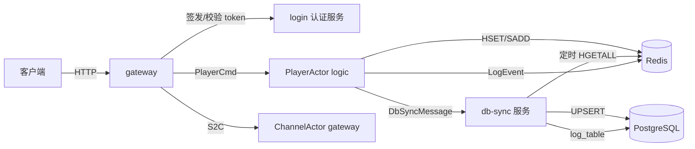

# xs-net 改造计划书：Actor 存储 Redis 化与节点职责重划

- 日期：2026-08-14
- 版本：v1.1
- 状态：方案定稿（4 项关键决策已确认，9 项优化点已并入）
- 范围：仅编写改造计划，不含代码实现
- 对应需求：1.1 PlayerActor 迁移 logic；1.2 彻底移除背包；1.3 login 只做签发与验证；2.1 logic 仅 Redis；2.2 actor 存储入 Redis；2.3 actor 创建销毁同步 PG；2.4 对齐参考项目的 write-behind 落库链路

## 更新记录

- v1.0（2026-08-14）：初稿，确认 4 项关键决策。
- v1.1（2026-08-14）：并入 9 项优化点，补充目录与结构化整理。

## 目录

1. 现状分析
2. 改造目标
3. 目标架构
4. 详细设计
5. 配置变更
6. 数据迁移与上线顺序
7. 测试与验证
8. 风险与对策
9. 待确认与假设
10. 优化点索引

## 1. 现状分析

### 1.1 模块与节点

| 模块 | 当前角色 | 当前职责 |
| --- | --- | --- |
| game-node-gateway | gateway | HTTP 入口、JWT 生成/校验、消息路由、ChannelActor |
| game-node-login | login | PlayerActor/PlayerzzActor、直接 JPA 读写 users、背包初始化 |
| game-node-modules | logic/system | BackpackActor、LogActor，直接 JPA 读写 backpack_items/log_table |
| game-db | 库模块 | PO 与 Repository，没有独立部署入口 |
| game-message-action | 消息库 | CS/SC 协议与 Actor 消息 |

### 1.2 现有数据流

1. 客户端调用 gateway `/api/players/create`，gateway 生成 channelId 和 JWT，并把 `CS_LOGIN` 路由到 login 节点的 `PlayerMessage` 分片。
2. login 节点 `PlayerActor` 启动时直接通过 `UserRepository` 查/建 `users` 表，随后发 `BackpackInitMessage` 给 logic 节点的 `BackpackActor`。
3. `BackpackActor` 启动时从 `backpack_items` 全量加载，处理 `CS_BACKPACK_INFO`、`CS_USE_ITEM`，销毁时 `saveAll` 回写 PG。
4. `LogActor` 接收内部与客户端日志，直接 `saveAll` 写 `log_table`。
5. 玩家登出时 `PlayerActor` 发 `SC_Logout` 到 gateway，同时发 `BackpackCleanupMessage` 停掉背包 actor。

### 1.3 现状与目标的差距

- login 节点承担玩家数据创建，与“只做签发 token 和验证”冲突。
- logic 节点直接持有 PG 数据源与 JPA 依赖，违反“logic 只允许 Redis”。
- 背包以独立 actor + 独立表存在，需要彻底移除。
- 项目完全没有 Redis 依赖，actor 状态只存在于内存和 PG。
- 玩家下线才落库，缺少周期性 write-behind、强制落库点与 Redis 回灌工具。
- `PlayerActor` 与 `PlayerzzActor` 是重复实现，且 gateway 路由 `CS_LOGIN` 时以 playerName 作为 entityId，与 playerId 语义不一致。

## 2. 改造目标

1. `PlayerActor` 迁移到 logic 节点，成为集群分片实体，负责玩家运行时状态。
2. 彻底移除背包协议、背包 actor、背包消息、背包表和背包接口。
3. `game-node-login` 保留为独立认证服务，只对外提供签发 token 与校验 token 的能力。
4. logic 节点只访问 Redis，不持有 PG 数据源、JPA 或 game-db 依赖。
5. actor 状态以 Redis 为运行时唯一存储，PG 只作为最终落库目标。
6. actor 创建/销毁事件同步通知独立 db-sync 服务，由 db-sync 负责 PG 写入。
7. 落库链路对齐参考 Lua 项目：写路径主动上报、db-sync 内存记账、定时批量从 Redis 全量 UPSERT、下线与关闭强制落库。
8. 附带目标：Redis 写入原子化、批量落库、可观测性、依赖面 CI 校验等优化随方案落实或纳入可选扩展。

## 3. 目标架构

目标数据流：

1. 客户端请求 gateway，gateway 调 login 签发 JWT，再把玩家进入消息发给 logic 的 `PlayerActor`。
2. `PlayerActor` 首次创建时从 Redis 加载状态；Redis 无数据则通过 db-sync 从 PG 加载或新建，并写回 Redis。
3. 玩家状态变更只改内存并标记脏字段，定时把脏字段 HSET 到 Redis，同时通知 db-sync 记账。
4. db-sync 按配置周期扫描脏集合，从 Redis 读取最新完整 hash，生成 UPSERT 写 PG。
5. 玩家下线时 `PlayerActor` 立即全量写 Redis 并通知 db-sync 强制落库；服务关闭时做全量落库。

## 4. 详细设计

### 4.1 节点职责重划

| 节点 | 目标职责 | 可访问数据源 |
| --- | --- | --- |
| game-node-gateway | HTTP 入口、认证代理、消息路由、S2C 回包 | login HTTP、Akka、Redis（可选会话缓存） |
| game-node-login | 只签发 JWT 与校验 JWT | 无 PG、无 Redis、无游戏数据 |
| game-node-modules | PlayerActor、LogActor、业务逻辑 | 仅 Redis、Akka |
| game-db（db-sync 服务） | Redis 脏数据回灌 PG、actor 创建/销毁落库、日志落库、回灌工具 | Redis + PG |

### 4.2 PlayerActor 迁移到 logic

1. 删除 `game-node-login` 下的 `PlayerActor.java` 与 `PlayerzzActor.java`。
2. 在 `game-node-modules` 新建 `com.game.logic.actor.PlayerActor`，仍继承 `AbstractBehavior`，消息接口改为 logic 侧。
3. `PlayerMessage` 接口从 `com.game.message.actor.login` 迁移到 `com.game.message.actor.logic`，`@Roles` 从 `"login"` 改为 `"logic"`，相关 import 同步修改。
4. `PlayerActor` 不再使用 `UserRepository`/`User`，改为使用 logic 内部的 `PlayerState` DTO 与 `RedisStore`。
5. gateway 的 `PlayerController.createPlayer` 修复 entityId 语义：`AkkaKit.tell(PlayerMessage.class, request, request.getPlayerId())`，不再用 playerName。
6. 玩家首次进入时 `PlayerActor` 执行 `ensureLoaded()`：
   - Redis 已存在 `player:{playerId}`，直接加载为 `PlayerState`。
   - Redis 不存在，向 db-sync 发 `DbSyncLoadMessage(playerId)`，由 db-sync 从 PG 读取或创建默认用户并写入 Redis，返回 ack 后继续。
   - 加载期间通过 ask 等待，超时或失败则拒绝进入并停止 actor。
7. `PlayerActor` 销毁路径统一为：登出消息或 Akka `PostStop`，先全量写 Redis，再发 `DbSyncMessage(playerId, DESTROY)`，最后停止。
8. 首次加载优化（后续可选）：v1 采用同步 ask；当玩家量与首登频率上升后，改为 Redis 未命中时先回 Loading，再异步加载完成通知，避免首登等待 db-sync。

### 4.3 彻底移除背包

删除以下内容：

- `game-node-modules/.../logic/actor/BackpackActor.java`
- `game-node-gateway/.../controller/BackpackController.java`
- 协议类：`CS_BACKPACK_INFO`、`SC_BACKPACK_INFO`、`CS_USE_ITEM`、`SC_USE_ITEM`、`BackpackItemInfo`
- 内部消息：`BackpackInitMessage`、`BackpackInitAckMessage`、`BackpackCleanupMessage`
- `game-db` 中的 `BackpackItem` 与 `BackpackItemRepository`
- `ChannelActor` 中 `backpackInfo`、`useItem` 两个分支

同时：

- 协议号 2000-2003、3000-3002 标记为已废弃，禁止复用，避免新旧客户端协议串号。
- PG 中 `backpack_items` 表先备份，确认无业务需要后删除。
- 更新 game-server README 的消息协议表。

### 4.4 login 独立认证服务

1. `game-node-login` 增加 `spring-boot-starter-web`，对外提供：
   - `POST /api/auth/issue`：入参 `{playerId, playerName}`，出参 `{token, expiresAt}`。
   - `POST /api/auth/verify`：入参 `{token}`，出参 `{valid, playerId, channelId}`。
2. `JwtUtil` 从 `game-comment` 拆到独立公共模块（建议新建 `game-auth`），由 login 与 gateway 共同依赖；若短期不想新增模块，可先保留在 `game-comment`，但 login 必须移除 game-db 依赖。
3. login 不再创建用户、不再读写 `users`、不再持有任何游戏 actor。
4. login 默认不校验玩家是否已存在，签发是纯 JWT 行为；玩家存在性由 db-sync 在 `PlayerActor` 创建时保证。此点列为假设，可后续调整。
5. gateway 的 `JwtAuthFilter` 默认使用 `game.auth.verify-mode=local`，用共享密钥本地校验，避免每请求远程调用；`remote` 模式调用 login `/api/auth/verify`，适合审计或跨服务校验，需配置超时并采取 fail-closed 策略。
6. 可选扩展（运营需要时启用）：Redis token 黑名单实现踢人，或引入短 token + refresh token；默认不启用。
7. login 若不再加入 Akka 集群，可移除 Akka 依赖与 `application.conf`，只保留 HTTP 服务。

### 4.5 Redis Actor 存储模型

键命名：

| 用途 | Key | 类型 |
| --- | --- | --- |
| 玩家 actor 状态 | `player:{playerId}` | Hash |
| 玩家全量索引 | `idx:player` | Set |
| 在线玩家集合 | `player:online` | Set |
| 待落库脏集合 | `sync:dirty:player` | Set |
| 创建/销毁事件 | `sync:event:player` | Stream 或 List |
| 日志事件 | `log:events` | Stream |

`player:{playerId}` 字段：

| 字段 | 说明 |
| --- | --- |
| id | 玩家 ID |
| name | 玩家名 |
| email | 预留字段 |
| online | 1 在线，0 离线 |
| last_login_at | 最后登录时间 |
| updated_at | 最后更新时间 |
| version | 乐观版本号 |

脏标记与写路径：

1. `PlayerState` 提供 `markDirty(field)`，业务修改字段后立即标记。
2. `RedisStore.flushDirty(playerId, state)` 通过 Lua 脚本原子执行：只把脏字段 `HSET` 到 `player:{playerId}`，再把 playerId `SADD` 到 `sync:dirty:player`；脚本成功后向 db-sync 发 `DbSyncMessage(playerId, UPDATE)`，避免进程中断出现“状态已写但脏集合未记”的半完成状态。
3. `PlayerActor` 用 Akka Timers 定时触发 `flushDirty`，默认 1 秒，可配置 `game.storage.sync-interval-ms`。
4. 创建时写全量 hash 并加入 `idx:player`、`player:online`；销毁时写全量 hash、移出 `player:online`，并向 `sync:event:player` 投递 `{playerId, op: CREATE|DESTROY, ts}` 或直接发对应 `DbSyncMessage`。
5. 创建/销毁事件建议写入 Redis Stream，用消费组支持 db-sync 水平扩展与断点续读；单实例场景可用 List + 阻塞读取。

### 4.6 db-sync 服务与 PG 落库

#### 模块改造

- 将 `game-db` 从纯库模块升级为可独立部署的 Spring Boot 服务，新增主类 `com.game.DbSyncApplication`。
- 保留 `User`、`UserAccount`、`LogEntity` 及对应 Repository；删除背包 PO。
- 新增依赖：`spring-boot-starter`、`spring-boot-starter-data-redis`、Akka 相关依赖、`game-message-action`。
- 新增 `application.yml` 与 `application.conf`：Akka 端口 5001，角色 `["db"]`，加入集群 seed-nodes。
- 建议保留模块名 `game-db` 以减少 Maven 依赖链改动；若团队希望命名更清晰，可改名为 `game-node-db-sync`，属于可选项。

#### 通信通道选型

- 方案 A（当前主选）：db-sync 作为 Akka 集群节点，角色 `db`，接收 logic 的 `DbSyncMessage`，语义最贴近参考项目的 dbMan 主动上报。
- 方案 B（更轻量备选）：db-sync 不加入 Akka 集群，logic 把事件写入 Redis Stream `sync:event:player`，db-sync 用消费组读取；部署更独立、易水平扩展，logic 故障不影响 db-sync 扫脏。
- 决策建议：若优先保留参考项目消息语义，选 A；若优先运维简单与扩展性，选 B。实施前需二选一定稿，本计划其余章节按 A 展开，B 作为不改变 Redis/PG 设计的替代实现。

#### DbSyncActor 设计

| Lua 参考 | xs-net 对应实现 |
| --- | --- |
| `fieldObject.__newindex` 脏字段收集 | `PlayerState.markDirty` |
| `serviceObject` 每秒 `syncToRedis` | `PlayerActor` 定时器 + `RedisStore.flushDirty` |
| `saveRedis` hmset + set 索引 + modify 通知 | `RedisStore` HSET + SADD 脏集合 + 发 `DbSyncMessage` |
| `dbMan.modify` 内存记账 | `DbSyncActor` 维护 per-player 脏集合，同一玩家多次更新只保留一份 |
| `dbMan.bgSave` 周期 `save()` | `DbSyncActor` 定时器，默认 3 秒，可配置 `game.db.bgsave-seconds` |
| `db.saveCacheEx` 从 Redis 读全量再 REPLACE INTO | `DbSyncActor` `HGETALL player:{id}` 后 JPA upsert 或原生 `INSERT ... ON CONFLICT` |
| 玩家下线 `savePlayerNow` | `DbSyncMessage(DESTROY)` 后立即 `savePlayerNow` |
| 服务器关闭 `shut -> save` | logic 与 db-sync 的 shutdown hook 全量落库 |
| `Redis2Mysql` 全量回灌 | db-sync 提供 PG 到 Redis 的 backfill 命令 |

落库规则：

- `DbSyncActor` 收到 `DbSyncMessage` 只做内存记账，不立刻 SQL。
- 定时器触发后，遍历脏玩家，从 Redis 读取最新完整 hash，再写 PG；成功后 `SREM sync:dirty:player` 并清内存记账。
- 批量写 PG 使用 JdbcTemplate 原生 `INSERT ... ON CONFLICT (id) DO UPDATE` 或批量 UPSERT，替代 `saveAll` 逐条写；按 playerId 哈希分成 N 个分片并行落库，并发上限可配置（默认 4）。
- 同一玩家高频变更做最小间隔去抖，短周期内只落一次，减少高频玩家写库次数。
- CREATE 使用 upsert；DESTROY 使用 upsert 并置 `online=0`，不物理删除用户行。
- 写库失败保留脏记录，下个周期重试；连续失败告警。
- db-sync 暴露 Actuator 指标：脏集合深度、单轮落库耗时、落库失败数、日志 backlog、分片并发数。
- db-sync 关闭时先处理剩余脏数据再退出。

#### 对账与回灌

- backfill 工具在回灌结束后生成 PG 与 Redis 的对账报告（总数、缺失、字段差异抽样）。
- 上线前执行一次全量对账；日常提供按需对账命令。

### 4.7 日志链路调整

logic 不再允许访问 PG，因此 `LogActor` 同步改造：

1. `LogActor` 删除 `LogRepository`、`LogEntity` 依赖，改为把日志事件写入 Redis `log:events`。
2. db-sync 新增日志消费者，按批读取 `log:events` 并 `saveAll` 写入 `log_table`。
3. 原 `BATCH_SIZE=1` 的直写策略取消，批量大小由 db-sync 配置 `game.db.log-batch-size` 控制。
4. `CS_LOG_REPORT` 的客户端应答逻辑保留在 `LogActor`，只把落库部分移交给 db-sync。
5. 玩家数据落库与日志落库使用独立 actor/队列；日志失败只重试日志，不阻塞玩家状态落库。

### 4.8 消息与协议调整

移除：

- `BackpackInitMessage(3000)`
- `BackpackInitAckMessage(3001)`
- `BackpackCleanupMessage(3002)`
- `CS_BACKPACK_INFO(2000)`、`SC_BACKPACK_INFO(2001)`、`CS_USE_ITEM(2002)`、`SC_USE_ITEM(2003)`

新增：

- `DbSyncCmd` 接口，`@Roles("db")`。
- `DbSyncMessage(playerId, op)`：op 为 UPDATE/CREATE/DESTROY。
- `DbSyncLoadMessage(playerId)`：logic 向 db-sync 请求加载或创建玩家。
- 日志事件建议使用 Redis JSON 消息，不新增协议号；如需走 Akka 可在 `DbSyncCmd` 下新增 `LogFlushMessage`。

保留并调整：

- `CS_LOGIN(1000)`、`CS_Logout(1001)`、`SC_LOGIN(1002)`、`SC_Logout(1003)` 保留，路由目标改为 logic。
- `SC_LOGIN` 去掉 `implements PlayerMessage`，它只作为 HTTP 响应 DTO，不应进入 actor 分片路由。
- `PlayerMessage` 迁移包名并改 `@Roles("logic")`。
- `C2S`、`S2C`、`XSSystem` 接口保留，`C2S` 暂无可注册 actor，留给后续业务模块。
- HTTP DTO 与内部消息拆分：新增 `LoginRequest`（login/gateway HTTP DTO）与 `PlayerEnter`（logic 内部消息）；`CS_LOGIN` 若继续作为网络协议保留，则不直接作为 actor 消息使用，避免网络协议约束内部实现。
- 协议号按模块分区间维护，新增登记表：1000-1999 用户/认证，2000-2999 背包废弃区段，3000-3099 内部消息，3100-3199 db-sync。

### 4.9 权限与部署隔离

代码层面：

- `game-node-login`、`game-node-modules` 的 pom 移除 `game-db` 依赖。
- `game-node-login`、`game-node-modules` 的 `application.yml` 移除 `spring.datasource`、`spring.jpa` 配置。
- `game-node-modules` 新增 `spring-boot-starter-data-redis` 与 Redis 配置。
- 全仓库搜索确认无其他模块直接引用 `UserRepository`、`BackpackItemRepository`、`LogRepository` 后，再把它们收拢到 db-sync。
- 新增 CI 校验：logic 模块测试中扫描 classpath，断言不包含 `org.postgresql`、`jakarta.persistence`、`game-db` 相关类，从编译/测试层面守住权限边界。

部署层面：

- 建议使用 Docker Compose 或防火墙限定网络：logic 只可达 Redis；db-sync 可达 Redis 与 PG；login 只对外暴露 HTTP；gateway 可达 login 与 Akka。
- PG 凭据只配置在 db-sync；Redis 凭据只配置在 logic 与 db-sync。
- 所有节点 seed-nodes 统一更新：login 退出集群后，由 gateway、logic、db 节点组成集群。

## 5. 配置变更

| 文件 | 变更 |
| --- | --- |
| game-node-modules `application.yml` | 删除 datasource/jpa；新增 `spring.data.redis.*`、`game.storage.sync-interval-ms` |
| game-node-login `application.yml` | 删除 datasource/jpa；新增 HTTP 端口、`jwt.*` |
| game-node-login `application.conf` | 若退出 Akka 集群则删除 |
| game-db `application.yml` | 保留 datasource/jpa；新增 `spring.data.redis.*`、`game.db.bgsave-seconds`、`game.db.log-batch-size`、`game.db.flush-concurrency`，启用 Actuator 指标 |
| game-db `application.conf` | 新增，Akka 端口 5001，角色 `["db"]`（方案 B 则不需要） |
| game-node-gateway `application.yml` | 新增 login 地址、`game.auth.verify-mode=local` |
| 各节点 `application.conf` | seed-nodes 列表统一调整 |

环境变量建议：

- login/gateway：`JWT_SECRET`、`LOGIN_BASE_URL`
- logic：`REDIS_HOST`、`REDIS_PORT`、`REDIS_PASSWORD`
- db-sync：`REDIS_HOST`、`REDIS_PORT`、`REDIS_PASSWORD`、`DB_URL`、`DB_USERNAME`、`DB_PASSWORD`

## 6. 数据迁移与上线顺序

### 阶段一：Redis 与 db-sync 基础设施

- 准备 Redis 实例并确认 AOF 开启（建议 `appendfsync everysec`）。
- 完成 `game-db` 服务化改造与 `DbSyncActor`。
- 启动 db-sync，验证能加入 Akka 集群。
- 启用 Actuator 指标与监控告警。

### 阶段二：PG 到 Redis 回灌

- 用 db-sync 的 backfill 命令扫描 `users`，生成 `player:{playerId}` hash 与 `idx:player`。
- 校验回灌数量与抽样字段。
- 生成 PG 与 Redis 对账报告，核对总数、缺失与字段差异。
- 上线前保留 `backpack_items` 备份，确认客户端已停用后再删除。

### 阶段三：PlayerActor 迁移与 login 认证化

- 完成消息接口迁移、PlayerActor 重写、login 认证接口。
- 先灰度 logic 新 PlayerActor，验证登录、Redis 写入、db-sync 落库。
- login 切换为只签发/校验，不再创建用户。

### 阶段四：背包移除

- 删除背包代码与协议。
- 更新客户端协议版本，服务端对废弃协议号返回明确错误。
- 删除 `backpack_items` 表。

### 阶段五：权限收紧

- 移除 logic/login 的 PG 配置与依赖。
- 按 Compose/防火墙规则隔离网络。
- 验证 logic 在无 PG 凭据环境下完整运行。

### 阶段六：联调与上线

- 全链路验证：登录、状态变更、下线强制落库、服务关闭全量落库、db-sync 重启续跑。
- 准备回滚方案：保留旧版本 jar，Redis 回灌失败时可临时关闭 db-sync，logic 继续内存运行但落库延迟。
- 故障演练：分别停止 Redis、db-sync、logic，验证恢复后数据一致性与指标恢复。

## 7. 测试与验证

### 单元测试

- `RedisStore`：脏字段合并、Lua 原子脚本（HSET+SADD 不产生半完成状态）、key 命名。
- `PlayerState`：字段标记与序列化。
- `DbSyncActor`：内存记账合并、定时落库、失败保留脏数据。
- `JwtUtil`：签发、校验、过期与篡改。

### 集成测试

- login `/api/auth/issue` 与 `/api/auth/verify`。
- gateway 调 login 后向 logic 路由 `PlayerCmd`。
- `PlayerActor` 创建时从 PG 加载并写 Redis，销毁时触发 db-sync 落库。
- db-sync 周期落库与 `log:events` 批量写 `log_table`。
- 验证 logic 编译与运行不依赖 game-db/JPA。
- 使用 Testcontainers 启动 Redis 与 PostgreSQL，覆盖 db-sync 完整链路。
- CI classpath 断言：logic 依赖中无 PostgreSQL/JPA/game-db。
- 故障演练：停止 Redis/db-sync/logic 后的恢复与一致性校验。

### 验证命令

- 根目录：`./mvnw.ps1 -DskipTests package`
- 局部：`mvn -pl game-server/game-node-modules -am test`
- 局部：`mvn -pl game-server/game-db -am test`
- 联调环境统一把构建/测试日志写入 `.log/`，避免污染源码目录。

## 8. 风险与对策

| 风险 | 对策 |
| --- | --- |
| Redis 崩溃导致丢最近周期数据 | AOF everysec；db-sync 定时周期尽量短；下线与关闭强制落库；脏集合持久化后可续跑 |
| Redis 与 PG 短时不一致 | 以 Redis 全量 hash 为准，UPSERT 幂等；失败保留脏集合重试 |
| 首次登录依赖 db-sync 加载，延迟或超时 | ask 超时与错误码；加载失败不进入游戏；db-sync 提前回灌 |
| 并发创建同一玩家 | Akka 分片保证单实体；db-sync 加载幂等；PG 唯一约束兜底 |
| 移除背包导致旧客户端异常 | 协议版本协调；废弃协议号保留错误响应 |
| logic 残留 PG 依赖 | 移除 pom 依赖与配置后，通过编译和启动验证把关 |
| `PlayerzzActor` 与 `PlayerActor` 重复注册 | 迁移时同时删除两个旧类，只保留 logic 新实现 |
| gateway 远程校验增加每请求延迟 | 默认 local 校验；remote 仅用于审计或跨服务校验 |
| 日志 backlog 阻塞玩家落库 | 玩家与日志队列分离，独立重试与死信 |
| db-sync 单 actor 落库吞吐不足 | 分片并行 + 批量 UPSERT + 去抖合并 |

## 9. 待确认与假设

以下按已确认决策或合理假设记录，实施前如有变化再修订：

1. login 签发 token 前不校验玩家是否存在，玩家存在性由 db-sync 在 actor 创建时保证。
2. db-sync 通信通道：方案 A（Akka 角色 `db`）为本计划主选，方案 B（纯 Redis Stream）为备选，实施前需定稿。
3. `game-db` 模块保留名称并升级为 db-sync 服务，不强制重命名为 `game-node-db-sync`。
4. 背包玩法彻底下线，`backpack_items` 数据备份后删除。
5. `SC_LOGIN` 仅作为 HTTP 响应 DTO，不再参与 actor 路由。
6. Redis 写入使用 Lua 脚本保证原子性，事件使用 Stream 或 List。
7. gateway 默认 `game.auth.verify-mode=local`；remote 校验、token 黑名单、refresh token 为可选扩展。
8. 首次加载 v1 采用同步 ask，异步化列为后续优化。

## 10. 优化点索引

| 优化点 | 落点 |
| --- | --- |
| Redis 写入原子化 | 4.5、9 |
| 批量 UPSERT 与分片并行落库 | 4.6、8 |
| db-sync 可观测性与对账 | 4.6、5、6、7 |
| logic 依赖面 CI 校验 | 4.9、7 |
| HTTP DTO 与内部消息拆分 | 4.8 |
| 日志与玩家数据分离 | 4.7、8 |
| db-sync 通信通道选型 | 4.6、9 |
| 认证校验模式与踢人/refresh | 4.4、5、8 |
| 首次加载异步化 | 4.2、9 |
