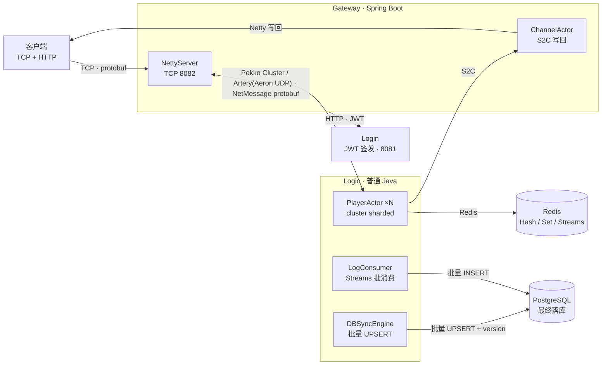

# xs-net 架构文档

> 本文档描述 xs-net 当前架构、数据流转与服务边界。
> 更新日期：2026-08-27

## 架构总览

## 数据流转

### 上行：客户端到 Logic

1. 客户端连接 Gateway 的 TCP 8082，首个帧发送 UTF-8 JWT；认证通过后，Gateway 将 JWT 中的 `cid` 绑定到 Netty Channel。
2. 后续游戏消息使用 XS packet：`length(4) | packetId(2) | sendSeq(4) | random(4) | headCRC(2) | bodyCRC(2) | body(N)`，全部为大端序；`DATA` 包的 `body` 是 `NetMessage` Protobuf 字节。TCP/WebSocket/自研 UDP 共用该包头，TCP 通过 `length` 完成拆帧。
3. Gateway 根据 `rpcNum` 查找协议契约，解码 `data`，提取 `playerId` 后通过 Pekko Cluster Sharding 投递到 Logic 的 `PlayerActor`。

### 下行：Logic 到客户端

1. `PlayerActor` 将 S2C 消息投递给以 `channelId` 为实体 ID 的 `ChannelActor`。
2. Gateway 从 `ChannelRegistry` 取得 Netty Channel，将 `NetMessage` Protobuf 放入 XS packet 的 `DATA` body 后写回客户端。

### 认证

客户端请求 Gateway HTTP 8080；Gateway 调 Login 服务签发 JWT，并在 Gateway 本地校验该 JWT。JWT 的 `sub` 是 `playerId`，`cid` 是下行路由使用的 `channelId`。

### 状态与日志持久化

1. `PlayerActor` 将脏状态写入 Redis，并提交给 `DBSyncEngine`。
2. `DBSyncEngine` 定时批量 UPSERT PostgreSQL，以 `version` 做乐观锁控制。
3. 日志事件写入 Redis Streams；`LogConsumer` 通过消费者组批量消费并写入 PostgreSQL。

## 服务边界

- **Gateway** 负责连接、认证、协议编解码和跨节点路由，不直连 Redis 或 PostgreSQL。
- **Login** 只负责 JWT 签发与校验，不创建玩家、不处理游戏状态。
- **Logic** 承担游戏状态、Redis 访问和 PostgreSQL 异步持久化；它不使用 Spring Boot，由普通 Java 启动流程装配。

## 技术栈

| 技术 | 版本 | 用途 |
|---|---|---|
| Java | 21 | 开发语言 |
| Spring Boot | 4.0.0 | Gateway / Login Web 框架 |
| Apache Pekko | 1.1.5 | Cluster + Sharding，Artery/Aeron UDP 传输 |
| Netty | 4.1.115 | Gateway TCP 长连接 |
| Protobuf | 3.25.5 | `NetMessage` 信封及消息序列化 |
| Redis | - | Logic 运行时状态和 Streams |
| PostgreSQL | - | 最终持久化 |
| JWT (jjwt) | 0.12.6 | 身份认证 |
| Micrometer | 1.16.0 | Logic 与 Gateway 指标 |

## 模块清单

| 模块 | 说明 |
|---|---|
| `xs-net/xs-net-core` | Pekko 封装、`RpcActor`、分片初始化与 Actor 创建缓存 |
| `xs-net/xs-net-message` | `NetMessage` 信封、注册表、协议契约与编解码能力 |
| `xs-net/xs-net-rpc-maven-plugin` | RPC 协议与 SDK 生成 Maven 插件 |
| `xs-net/xs-net-sdk` | SDK 打包模块 |
| `xs-net/xs-net-tools` | 工具模块 |
| `game-server/game-node-gateway` | Netty 长连接、JWT 校验、Pekko 路由和 S2C 写回 |
| `game-server/game-node-login` | JWT 签发与校验 |
| `game-server/game-node-modules` | `PlayerActor`、`DBSyncEngine`、`LogConsumer`；非 Spring Boot |
| `game-server/game-message-action` | 游戏 protobuf、DTO、路由接口与 RPC 注册表 |
| `game-server/game-comment` | JWT 等公共工具 |

## 已移除组件

- `game-client`：联调/压测客户端模块，压测端迁移至 `xs-net-sdk`；
- 独立 db-sync 服务：批处理能力下沉进 Logic 的 `DBSyncEngine` 和 `LogConsumer`；
- SBE 序列化：协议统一使用 Protobuf；
- db-sync 跨节点消息协议（3100-3102）。
