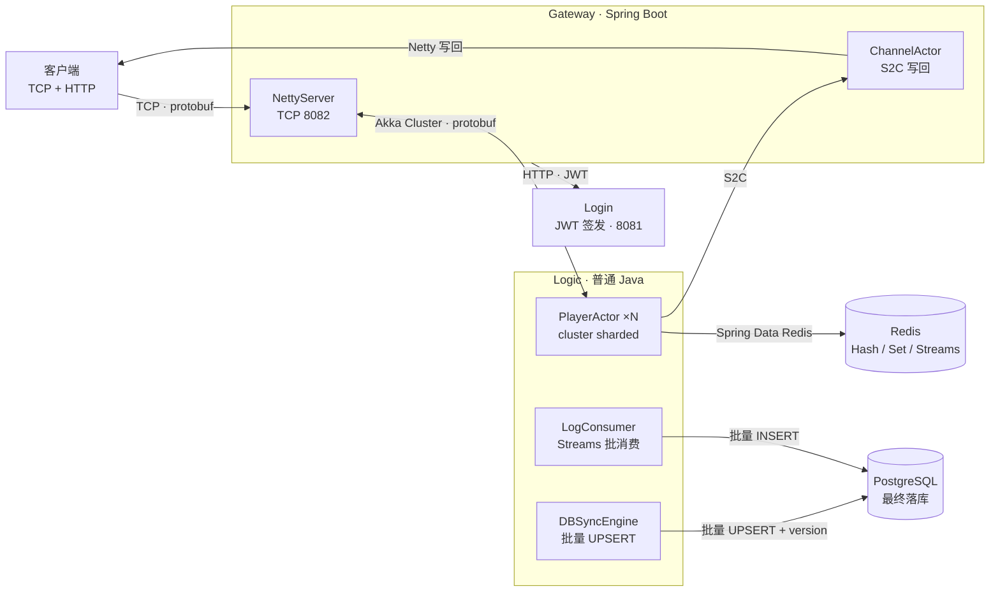

# xs-net 架构文档

> 本文档描述 xs-net 当前（优化后）的架构、数据流转与技术栈。
> 更新日期：2026-08-21

## 1. 架构总览

## 2. 数据流转

### 2.1 上行（客户端 → 逻辑）

1. 客户端 TCP 连接 Gateway（8082），首帧发送 JWT token 认证，通过后绑定 `channelId` 到 Netty Channel。
2. 游戏消息帧为 `4 字节长度前缀 + NetMessage(rpcNum, payload)`，Netty 解码后经 Akka Cluster 路由到 Logic 的 `PlayerActor`（entityId = playerId）。

### 2.2 下行（逻辑 → 客户端）

3. `PlayerActor` 发送 S2C 消息 → Akka Cluster → Gateway `ChannelActor`（entityId = channelId）→ 从 ChannelRegistry 取 Netty Channel 编码写回客户端。

### 2.3 认证

4. 客户端 HTTP 请求 Gateway（8080）→ `RestClient` 调 Login 签发 JWT；Gateway 本地验签（parser 缓存 + 60s token 缓存，remote 模式可跳过远程调用）。

### 2.4 状态落库（写合并）

5. `PlayerActor` 脏字段 → Redis Hash/Set 即时写（跨节点可见 + 崩溃恢复源）+ `DBSyncEngine.submit`。
6. `DBSyncEngine` 定时批量 UPSERT → PostgreSQL（`WHERE version = ?` 乐观锁，失败重试，脏记录上限告警）。

### 2.5 日志落库

7. `PlayerActor` 写 Redis Streams（protobuf `LogRecordMessage` 序列化）→ `LogConsumer` XREADGROUP 阻塞消费 → 批量 INSERT PostgreSQL（坏消息跳过，兼容旧 JSON 格式回退）。

### 2.6 玩家加载

8. `PlayerActor` 读 Redis 缓存，miss → `DBSyncEngine.loadOrCreate` 从 PostgreSQL 回填 Redis。

## 3. 技术栈

| 技术 | 版本 | 用途 |
|---|---|---|
| Java | 21 | 开发语言 |
| Spring Boot | 4.0.0 | Gateway / Login Web 框架 |
| Akka | 2.8.5 | Cluster + Sharding，Artery/Aeron UDP 传输 |
| Netty | 4.1.115 | Gateway TCP 长连接 |
| Protobuf | 3.25.5 | 消息序列化（NetMessage 信封） |
| Redis | - | 运行时存储（Lettuce + commons-pool2 连接池） |
| PostgreSQL | - | 最终落库（HikariCP + Spring JDBC） |
| JWT (jjwt) | 0.12.6 | 身份认证（parser 缓存） |
| Micrometer | 1.16.0 | Logic 指标（flush 延迟 / dirty 深度 / 失败计数） |
| Lombok | 1.18.42 | 代码简化 |
| Maven | 3.9.x | 构建（mvnw 自动探测 IDEA/JDK 路径） |

## 4. 模块清单

| 模块 | 说明 |
|---|---|
| `xs-net/xs-net-core` | Akka 封装（Cluster/Sharding、Actor 创建缓存） |
| `xs-net/xs-net-message` | 消息协议（NetMessage 信封、序列化） |
| `xs-net/xs-net-tools` | 工具模块（tool-all 聚合） |
| `game-server/game-node-gateway` | 网关：Netty 长连接 + HTTP + JWT 校验 + Akka 路由 |
| `game-server/game-node-login` | 登录：JWT 签发/校验 |
| `game-server/game-node-modules` | 逻辑服：PlayerActor、DBSyncEngine、LogConsumer（非 Spring Boot） |
| `game-server/game-message-action` | 游戏消息定义（protobuf + RPC 注册表） |
| `game-server/game-comment` | 公共工具（JwtUtil 等） |

## 5. 已移除组件

- 独立 db-sync 服务（`game-db`）：批处理能力下沉进 Logic 的 `DBSyncEngine` / `LogConsumer`
- SBE 序列化（`tool-sbe`）：协议统一走 Protobuf
- DbSync 跨节点消息协议（3100-3102）