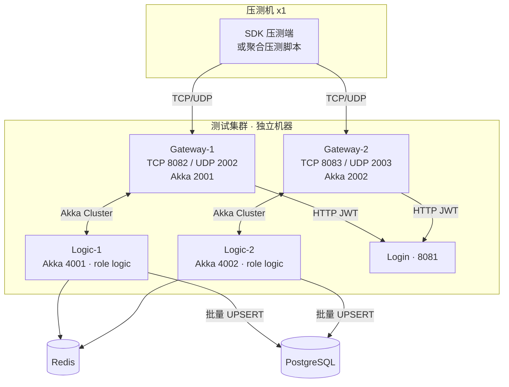

# xs-net 两个补充方向规划：规模化验证 与 跨服玩法层分片

> 规划文档 · 状态：草案（待评审）
> 面向对象：Logic 节点（非 Spring Boot，Akka Cluster + Sharding + Redis + PostgreSQL）
> 关联文档：[ARCHITECTURE.md](../../ARCHITECTURE.md)、[登录压测报告.md](../登录压测报告.md)
>
> **数据纪律声明**：本文所有性能数值一律只标注「实测」或「待测」两类。
> - 「实测」值取自《登录压测报告.md》中已记录的本机单机结果；
> - 凡未实际测量之处统一标注「待测」，禁止外推编造。
> 「单机 1200 登录/s 基准」口径以本机单机全链路（CS_Login→SC_Login）为准，与《登录压测报告》实测值的关系见 §方向A 基准表，属任务给定的简化基准而非实测。

---

## 0. 背景与定位

xs-net 当前已完成单机三节点（Logic / Gateway / Login）集群的登录闭环（CS_Login → PlayerActor → Redis/PG 落库 → S2C 回包），并产出本机单机压测基线。本规划补充两个相互独立、可先后或并行推进的方向：

- **方向A — 规模化验证（Scale）**：回答「架构是否以及如何扩展到多节点集群」。
  当前所有压测均在本机单机完成，`seed-nodes`、Aeron 传输、Cluster Sharding role 分配均只验证了单机场景。
  需设计一套多节点集群压测方案，给出拓扑、指标与验收标准，并与单机基准做量化对比。
- **方向B — 跨服玩法层分片（Cross-Server Gameplay Sharding）**：回答「玩法层如何在跨服/多服尺度上分片」。
  当前仅 PlayerActor 一层按 playerId 分片（事件哈希），所属世界是全局唯一的单世界，尚无「分线/合线、动态副本、跨服战场」等玩法层结构。
  需补齐能力设计，参考 ET 类框架的 Servers/Scene/Map 分层思路，并明确与现有事件哈希分片的**分层叠用**关系。

两者定位分层：方向 A 是**基础设施刻度**的验证，方向 B 是**玩法结构**的扩展设计；方向 B 的设计应能跑在方向 A 验证出的多节点集群之上。

---

## 方向A — 规模化验证：多节点集群压测方案

### A.0 当前基准（本机单机 · 实测）

以下为《登录压测报告.md》已记录的本机单机、三节点集群（Logic/Gateway/Login 同机）实测值，是多节点压测的对比基线：

| 链路（口径） | 实测值 | 备注 |
|---|---|---|
| TCP 全链路（CS_Login→SC_Login，并发 200） | ~850 登录/s（样本 757–961） | 调优后，含 DB 建行 + Redis 落库 + S2C 回包 |
| UDP 全链路（CS_Login→SC_Login，并发 1000） | ~990 登录/s（样本 897–1150） | 调优后、全链路判定口径 |
| UDP 全链路（并发 200） | 1522.1 登录/s | 打通闭环后、调优前口径 |
| UDP 全链路（并发 1000） | 1366.1 登录/s | 打通闭环后、调优前口径 |
| UDP 纯认证阶段（1000，不经过 PlayerActor） | 2415.5 登录/s | 仅连接+JWT 认证 |
| 单节点 Logsink/DB：单次 UPSERT 裸测（DBBench） | ~5000/s | DB 本身非瓶颈佐证 |

> 任务给定「单机 1200 登录/s 基准」为简化参考基准，与上表实测各区间的对应关系**待核**（见 A.6 待测项）。多节点压测对比时，**以本表实测为主线、以 1200/s 为约定的验收参照线**。

### A.1 压测目的

1. 验证 Cluster Sharding 在多节点上的**再平衡（rebalance）与故障转移**正确性（实体 Actor 会做阻塞式 Redis 访问，跨节点后该特性是否延续）。
2. 验证**网关多实例**与 Logic 多节点的路由正确性（网关按 rpcNum 解码后经 Cluster Sharding 投递到对应 Logic 节点）。
3. 得到**可叠加性结论**：吞吐随 Logic/Gateway 节点数增长是近似线性、还是受 Redis / PG / 种子节点单点限制。
4. 暴露多机网络（Aeron UDP 跨网卡）引入的时延与丢包影响。

### A.2 压测拓扑（建议）

计划压测拓扑（规划值，最终以实际部署为准）：



- Logic 节点上 `PlayerActor`（Cluster Sharding，`role = logic`）跨 L1/L2 分布；`S2C` 通道 shard 在 Gateway 侧。
- 网关双实例通过 `AKKA_PORT` 区分、各自独立 seed 或共享 seed 列表；按当前 `application.conf` 注释，生产需开启 Split Brain Resolver（多网段/多机才启用，本地双节点保持关闭）。
- **待测**：是否引入独立压测机（避免压测机与服务器争用本机资源），以及 Redis / PG 是否独立部署、是否引入高可用（主从/PGM，见 A.6）。

### A.3 指标

- **吞吐**：登录/s（全链路判定 = 收到 SC_Login）。分 TCP / UDP、分并发档（建议 200 / 500 / 1000，延续现有脚本口径）。
- **时延**：avg / p50 / p95 / p99 / max（沿用《登录压测报告》分位口径）。
- **成功率**：成功/总数，1000 玩家全量登录下要求 100%。
- **重平衡稳定性**：在压测进行中加入/摘除一个 Logic 节点，观察：
  - 期间吞吐回落幅度与时延抖动（重平衡期间 p99 抬升量）；
  - 实体再分配完成后是否恢复至稳态。
- **故障转移（待测）**：直接 kill 一个 Logic 进程，观察其控制的 shard 上的玩家登录/消息在另一 Logic 节点接管后的恢复时间（依赖 `remember-entities` 当前为 `off`，恢复语义需专门验证，见 A.6）。
- **资源指标**：CPU（实体 dispatcher 256 线程池）、内存、Redis 连接池（`maxTotal/maxIdle=32`）、PG 连接池（`max-pool-size=50`）。
- **网络**：Aeron 跨机 RTT、丢包率、Artery 握手与消息时延。

### A.4 与单机基准的对比方法（对比口径必须一致）

为保证与「单机 1200 登录/s」基准可比，多节点对比遵循：

1. **同口径**：同为 1000 玩家、TCP 并发 200 / UDP 并发 1000、全链路判定（CS_Login→SC_Login）、`--timeout-ms=30000`。
2. **分组对比**：
   - 单 Logic / 单 Gateway（复刻单机基线，先用它在多机拓扑上确认「分机后单节点不退化」）；
   - 单 Logic / 双 Gateway；
   - 双 Logic / 单 Gateway → 双 Logic / 双 Gateway（观察叠加方向）。
3. **可叠加判定**：以「单位 Logic 的登录/s」为原子指标。若双 Logic 吞吐 ≈ 2 × 单 Logic 即近似线性；若受限，需定位 Redis / PG / 种子节点单点。
4. 结果需落在数据表，全部标注「实测」，未测不得给数。

### A.5 验收标准（建议 · 待实际压测确认）

| 项 | 验收标准 |
|---|---|
| 正确性 | 多节点下 1000 玩家全量登录 100% 成功，无 ClassCast/ShardRegion 初始化异常 |
| 可叠加性 | 双 Logic 全链路吞吐 ≥ 1.5 × 单 Logic（弱线性），目标 ≥ 1.8 ×；低于 1.5 视为资源单点受限，需定位 |
| 与单机基准对照 | 双 Logic 全链路吞吐 > 单机 1200 登录/s（约定参照线）；时延 p99 不劣于单机同口径 p99 + 20%（跨机网络代价的容忍上限，数值待测校准） |
| 重平衡稳定性 | 压测中添加/摘除 Logic 节点，重平衡完成后吞吐恢复到稳态 ≥ 90%；重平衡期间无持久化丢失、无不可恢复错误 |
| 资源 | Redis / PG 连接池不成为瓶颈（dev 阶段单机已非瓶颈，多机扩容后重新验证） |

### A.6 待测项（明确未测量，须补齐实验）

> 以下均为尚未测量、需在实际压测中明确取得结果后填写的条目：

- **待测** 多机网络上 2×/3× 节点的真实吞吐、时延分位数据（上表 A.4 全部对比组）。
- **待测** Logic 扩容后 Redis / PG 是否成为单点：Redis 单实例吞吐上限、PG 单库 UPSERT 吞吐上限在多节点叠加后的表现。
- **待测** `remember-entities = off` 下的故障转移/恢复语义：kill Logic 后 shard 上的实体状态如何恢复，登录/消息空窗期多长。
- **待测** 独立压测机与同机压测的差异，避免压测机与服务器资源争用的干扰。
- **待测** 网关多实例（含网关代理 shard）在 Split Brain Resolver 关闭/启用下的行为差异。
- **待测** Production 部署参数：是否需要 PGM、Redis 主从/分片、多网段 seed 与防火墙端口放行策略。

---

## 方向B — 跨服玩法层分片：分线合线、动态副本、跨服战场

### B.0 动机

当前架构的数据/状态层次只有两层：

```
玩家归属层（PlayerActor，单一个体）
↑ 事件哈希分片：entityId = playerId，shard = hash(playerId)
```

也就是「每个玩家一个 Actor，按玩家 ID 哈希到集群」，这是**以玩家为单元**的分布。但玩法层有不少状态是**以场景/地图/服务线为单元**存在的（地图单位、NPC、掉落、跨服战场的副本场次）。若这些场景状态也寄附在某个「主玩家 Actor」里，会造成：单个玩家 Actor 承载整片场景状态、场景迁移困难、跨服战场无法独立伸缩。

方向 B 引入**玩法层分片**：在「玩家归属层」之上再叠一层「场景/副本归属层」，参考 ET 类框架（ET 的 Servers 多进程 + Scene 场景实体 + Map/地图 + 消息跨进程投递）把「服务线/世界/副本」建模为可独立调度和迁移的单元。

### B.1 分层模型：玩家归属层 × 玩法归属层（分层叠用）

不要把玩法层分片与 PlayerActor 事件哈希分片对立，二者**垂直叠用、各自独立分片**：

| 层次 | 分片键 | 分片实体 | 归属 | 状态持久化 |
|---|---|---|---|---|
| 玩家归属层 | `playerId` | PlayerActor | 玩家永久归属某个逻辑逻辑服/节点（迁移时可 Rebalance） | Redis → PG 行级 |
| 玩法归属层 | `sceneId`（服务线地图 / 战场副本实例 ID） | SceneActor（规划新增） | 场景单元可按需在逻辑节点间动态迁移 | Redis → PG 场景表（规划新增） |

- **事件哈希分片（现有）**：`PlayerActor` 按 `playerId` 哈希到 shard，负责单人状态与玩家间的常规交互。**保持不动**，作为玩家数据的稳定归属。
- **玩法层分片（规划新增）**：`SceneActor` 按 `sceneId`（= 服务线/地图/副本实例的统一标识）哈希到 shard（同一套 `ENTITY_DISPATCHER` 大线程池与 ClusterSharding 机制），负责一片地图或一场战场副本的共享状态。
- **分层叠用关系**：玩家通过其 PlayerActor 把「进入场景/同步场景状态/产生场景事件」的消息投递给目标 `SceneActor`；SceneActor 不重复维护玩家的归属（归属仍在 PlayerActor），只维护**地图/副本级**共享状态与**玩家明确登入的临时关联**。这样两种分片各自伸缩：玩家多时扩 PlayerActor shard，玩法重时扩 SceneActor shard，互不阻塞，且玩家换服/换线不破坏其 PlayerActor 归属。

> 关键设计原则：**PlayerActor 负责"我是谁、我的数据"，SceneActor 负责"我在这片地图/这场战斗里看得见什么"**。二者职责分离，是方向 B 与现有分片能干净叠用的前提。

### B.2 服务线（分线 / 合线）

「服务线」= 同一地图逻辑上的多份副本，用于容量横向扩展与玩家分流。

- 分线模型：一张地图有 N 条服务线，各自一个 `SceneActor`，`sceneId = {mapId, lineNo}`。
- 玩家进线：客户端请求进某条线 → PlayerActor 将该玩家登记进目标 `SceneActor` 的线内列表，返回线内快照（待测：快照量/拉取的带宽成本）。
- 合线（容量回收 / 玩家聚集）：需求是当低负载线空置或人数过少时，把线内玩家批量迁移到目标线：
  - **待测** 如何进行线内玩家重定向：推荐由 SceneActor 下发「迁移到 targetLine」指令，各在线的 PlayerActor 收到后把玩家的「线内关联」与新归属状态同步给目标 SceneActor，随后客户端重连/重定位目标线。
  - 状态一致性：线内共享状态（地图单位等，若有）需先做一次源场快照→目标场合并的交接；**待测** 若无地图共享状态仅玩家在线列表，则交接成本低（列表迁移即可）。
  - 合线触发条件（规划）：人数 < 阈值 或 迁移指令（运营触发），具体阈值参数化、**待测**。
- 线数动态扩缩：配合 B.3 动态副本。

### B.3 动态副本（扩容 / 缩容服务线副本）

服务的创建/销毁运行时化，而非启动时静态声明：

- 按地图并发（在线玩家数 / 请求量）触发副本数调整：
  - 扩容：新建一条服务线（新建 `sceneId={mapId, newLine}`，spawn 对应 SceneActor）并把过载线路的部分玩家转移过去；
  - 缩容：合线并销毁空置 SceneActor（stop / 摘除 shard）。
- 与 ClusterSharding 的关系：服务线副本实际上是「另一组 shard 实体实例」（同一 EntityTypeKey 下不同的 entityId），天然由 Sharding 分配到各 Logic 节点；副本数调整 = 实体 create/stop。跨节点调度由 Sharding 处理。
- 副本信息一致性：需要一张「地图 → 当前服务线列表 + 各自负载」的目录（建议存入 Redis 便于跨节点查看）。**待测** 目录的读写放大与缓存策略。
- 触发器（规划）：负载/人数阈值、定时巡检；接入监控指标后按实时指标驱动。

### B.4 跨服战场

多个逻辑服/分区的玩家进入同一场竞技场副本：

- 战场副本也是 `SceneActor`，`sceneId = {arenaId, instanceId}`；战场实例按场次动态创建（open→开始→结束→close），属于「玩法层分片」的一个特例。
- 分房（匹配）：由玩家 PlayerActor 提交匹配请求 → 匹配单元（规划：MatchActor，可按需求决定是否分片）在完成人数/队伍聚合后，创建战场实例并把参战玩家登记进该 SceneActor。
- 跨服语义：不同分区的玩家 PlayerActor 归属不同节点，但战场 SceneActor 是单一个体，跨节点玩家通过 `sceneId` 统一投递到同一战场实例 → 实现跨服会同场（实际是「跨节点投递到同一 shard 实体」）。
- 战场结束回收：结束时导出胜负/结算数据（待测：结算数据量；丢 Redis/PG 后 clear 战场 sceneId）。

### B.5 分片键选择与路由约定

- 玩家→场景路由：PlayerActor 内缓存「当前所在 sceneId + scene 状态」，由 PlayerActor 作为中转携带目标 sceneId；避免客户端直接指定 sceneId 造成的越权注入（进线/进战场的写操作由 PlayerActor 鉴权后发起）。
- 场景→玩家回传：SceneActor 需要把「视野/战斗广播」发给线内/场内玩家时，按玩家 playerId 经现有 PlayerMessage 路由回各自 PlayerActor（再由 S2C 下发客户端）。
- 收敛策略：任何跨层交互都只允许「PlayerActor ⇄ SceneActor」，玩家间交互仍走 PlayerActor（事件哈希），维持现有消息流方向（上行 Client→PlayerActor，下行 PlayerActor→ChannelActor/S2C）不被破坏。

### B.6 与现有系统/约束的衔接

- 非 Spring Boot 约束：SceneActor 亦为普通 Akka 实体，通过现有 `registerALocalActor` 扫描 + `@Roles` 注解注册为 `role = logic` 的 ClusterSharding 实体；复用 `ENTITY_DISPATCHER` 大线程池（阻塞式 Redis 访问场景与 PlayerActor 相同）。
- 持久化：`sceneId` 状态走 Redis + 批量 UPSERT PG（沿用 PlayerActor 的 load / dirty / flush / version 乐观锁模式），新增场景表结构**待设计**（scene_id 主键、地图/线号/实例字段、负载与版本）。
- 消息注册：进线/出线/战场等新 rpc 在 `game-server/game-message-action` 注册；纯玩法消息是否仍实现 `PlayerMessage` **待定**（若进线后部分交互直达 SceneActor，可能需要新的消息接口仅限 logic 内部投递，避免网关重复解析，需评估协议统计口径）。
- 运维/监控：动态副本与跨服战场引入新的 ELK/指标埋点（过程、成功率）。

### B.7 待测项（明确未测量，须补齐实验）

- **待测** 跨节点「PlayerActor → SceneActor」投递的端到端时延与吞吐（Aeron UDP 跨机 + Redis 读写）。
- **待测** 一张服务线/一场战场在一个 SceneActor 上的单实体吞吐上限（决定单线/单战场可容纳玩家数，从而定副本/分房粒度）。
- **待测** 合线迁移与副本缩容期间的玩家可见抖动/时延尖峰。
- **待测** 战场结算与场景状态的 Redis/PG 落库量级与延迟。
- **待测** 分线目录（地图→线路表）读写的放大系数与缓存必要性。
- **待测** SceneActor 阻塞式 Redis 访问在玩法层高频交互下是否成为瓶颈（与 PlayerActor 相比访问模式不同）。

---

## 里程碑建议（规划 · 时间不承诺）

| 阶段 | 内容 | 交付物 |
|---|---|---|
| A-1 | 多节点集群环境搭建 + 双网关/双 Logic 拓扑跑通 | 拓扑文档、压测脚本参数化支持多节点 |
| A-2 | 全量 A.4 对比组压测，产出实测数据表 | 多机压测数据、可叠加性结论 |
| A-3 | 重平衡 / kill 故障转移 / 资源单点专项 | 稳定性结论与参数建议 |
| B-1 | SceneActor 骨架 + 服务线（分线）跑通 | SceneActor、进线/出线流程 |
| B-2 | 动态副本（扩缩线）+ 合线 | 副本脚本、迁移流程 |
| B-3 | 跨服战场（匹配 + 会同场 + 结算回收） | MatchActor、战场实例生命周期 |
| B-4 | 玩法层负载/时延压测（B.7 待测项补齐） | 玩法层基准数据 |

> 方向 A 与方向 B 可并行；方向 B 的 B-1 可基于单机先行，B-2/B-3 建议在 A-2 验证后的多机环境上进行跨服验证。最终是否推进取决于各阶段实测数据与资源投入评审。

---

*文档生成：2026-08-28 · 作为产品规划草稿，所有标注「待测」的数值在取得实测前不得作为承诺指标。*