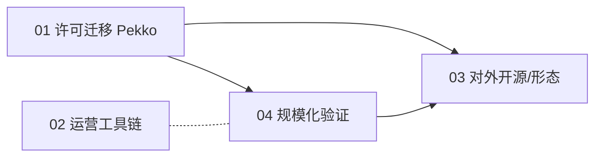

# xs-net 产品优化规划（Product Plan）

> 面向"将 xs-net 从内部代码库打磨为框架级产品"的分面规划汇总。
> 由 4 个独立规划面（许可/运营/形态/承载）并行产出，文件互不重叠。
> 更新日期：2026-08-28

---

## 规划面总览

| # | 文件 | 工作面 | 一句话结论 | 优先级 |
|---|---|---|---|---|
| 01 | [01-akka-pekko-migration.md](01-akka-pekko-migration.md) | 许可与技术底座 | Akka 2.8.5 → Apache Pekko 1.1.x，摆脱 BSL 商用许可约束、改动集中可控 | P0（前置） |
| 02 | [02-ops-toolchain.md](02-ops-toolchain.md) | 运营与保障工具链 | 补齐热更、GM、监控告警、部署编排、反作弊五块硬能力 | P0（上线前提） |
| 03 | [03-evolution-and-ecosystem.md](03-evolution-and-ecosystem.md) | 产品形态与生态 | 建议走"内部固化 → 开源"主线，外部发布前先完成 Pekko 迁移 | P1（择机发布） |
| 04 | [04-scale-and-cross-server.md](04-scale-and-cross-server.md) | 规模化验证 + 跨服玩法层 | 多节点压测验证承载 + 补齐玩法层分片（SceneActor 分层叠用） | P1（规模化） |

## 关联与依赖

- **01 → 03**：对外发布前必须完成 Pekko 迁移，避免 BSL 成为采用/交付障碍。
- **01 → 04**：多节点压测承载的集群底座即迁移后的 Pekko 集群。
- **04 → 03**：规模化数据（多机压测结果）是开源背书与商业化的素材。
- **02 ∥ 04**：运营工具链与规模化验证相对独立，可并行推进。

## 执行主线建议

1. **P0 · 底座**：按 `01` 完成 Akka→Pekko 迁移并跑通现有压测回归（这是后续一切的基础）。
2. **P0 · 可运营**：按 `02` 落地热更基础 + GM 指令 + 监控告警，达到"敢上线"。
3. **P1 · 规模化**：按 `04` 方向A 做多节点压测拿到可叠加性结论，再据此推进方向B 玩法层分片。
4. **P1 · 生态**：依 `03` 决策形态（内部/开源/商业化），迁移完成后启动文档站/示例/贡献指南。

## 共同准则

- 四份文档均遵循"区分 **现状（事实）** 与 **建议（规划判断）**"口径，不编造数据。
- 性能/容量相关数值一律标注「实测」或「待测」，未测量不得作为承诺指标。
- 深度内容见各分面文档；本文件仅作导航索引，不作为技术决策依据。