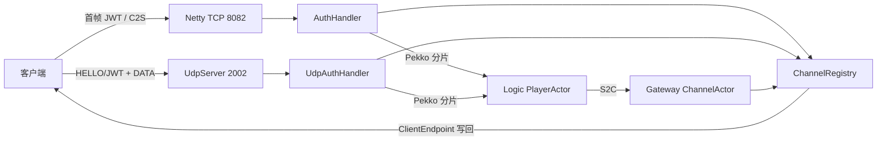

# Game Gateway（网关节点）

Gateway 面向客户端提供 Netty TCP 长连接与 UDP（轻量可靠 UDP）两种入口，负责 JWT 首帧认证、C2S 上行路由和 S2C 下行写回。它不直接访问 Redis 或 PostgreSQL；游戏状态和持久化属于 Logic 节点。

- 模块：`game-node-gateway`
- 技术：Java 21、Spring Boot、Netty、Pekko Cluster、Protobuf
- 默认端口：HTTP 8080、Netty TCP 8082、客户端 UDP 2002、Pekko UDP 2001

## 服务流程



1. 连接建立后，第一个长度前缀帧必须是 UTF-8 JWT；UDP 则先发 `HELLO(JWT)` 数据报，网关校验通过后回 `ACK` 完成握手；
2. `AuthHandler` / `UdpAuthHandler` 校验 JWT，读取 `cid` 并登记 `channelId → ClientEndpoint`（TCP 为 `TcpClientEndpoint`，UDP 为 `UdpSession`）；
3. 认证后的 C2S `NetMessage` 按协议号解码，提取 `playerId` 后投递至 Logic 的 `PlayerActor`；
4. Logic 的 S2C 消息以 `channelId` 路由至 `ChannelActor`，后者从注册表取回 `ClientEndpoint` 并写出（TCP 走帧编码，UDP 走可靠层 DATA 包）。

认证失败、认证超时或出现无法恢复的协议解析异常时，Gateway 关闭对应连接/会话。

## 帧协议

### TCP

Gateway TCP 上下行均使用 4 字节大端长度前缀：

```text
len (4B BE, 后续消息体长度) | NetMessage protobuf bytes
                              ├─ rpcNum
                              └─ data
```

首帧的消息体为 UTF-8 JWT；之后的消息体才是 `NetMessage`。单帧默认最大 65536 字节。`rpcNum` 位于 Protobuf 信封内，不存在独立的帧级 RPC 头。

### UDP（轻量可靠 UDP）

一个大 datagram 一个包，固定 15 字节头（大端）：

```text
偏移  长度  字段        说明
0     2    magic      0x58 0x53 ("XS")
2     1    type       1=DATA 2=ACK 3=HELLO 4=HEARTBEAT 5=ERROR
3     4    seq        发送方递增序列号（DATA 携带）
7     4    ack        累积确认：对端已收到的最大连续 seq
11    4    payloadLen payload 字节数
15    -    payload    DATA=NetMessage 字节 / HELLO=JWT(UTF-8)
```

- **握手**：客户端发 `HELLO(JWT)`，网关校验 JWT 后建立会话并回 `ACK`。
- **可靠传输**：双向对称（`UdpReliableLayer`），DATA 带递增 seq，接收方按序交付并回累积 `ACK`，发送方超时（`retry-interval-ms`）重传在途未确认包；乱序包缓存后补序。
- **心跳/清理**：客户端周期发 `HEARTBEAT`；网关后台每秒扫描，超过 `session-idle-timeout-seconds` 未活动的会话被清理，防止 UDP 无连接资源泄漏。
- UDP 会话以远端 `ip:port` 为 key，channelId 从 JWT 提取，单账号并发限制与 TCP 一致。

## 目录结构

```text
src/main/java/com/game/
├── GameGatewayApplication.java
└── gateway/
    ├── actor/ChannelActor.java
    ├── config/GatewayConfig.java
    ├── config/NettyConfig.java
    ├── config/UdpConfig.java
    └── netty/
        ├── AuthHandler.java
        ├── ChannelRegistry.java
        ├── ClientEndpoint.java        # 客户端端点抽象（TCP/UDP 统一写回）
        ├── TcpClientEndpoint.java     # TCP 端点
        ├── NettyChannelInitializer.java
        ├── NettyFramer.java
        ├── NettyServer.java
        ├── NettyServerLifecycle.java  # 同时启动 TCP 与 UDP
        ├── UdpAuthHandler.java
        ├── UdpReliableLayer.java
        ├── UdpServer.java
        └── UdpSession.java
```

## 配置

`src/main/resources/application.yml` 定义 HTTP 端口、Netty 端口、线程数、帧大小、认证超时、空闲超时、连接限制和 JWT 配置，以及 `game.udp.*`（UDP 端口、窗口、重传间隔、会话空闲超时等）。仓库内的 JWT 密钥仅用于本地开发；部署时必须覆盖，并与 Login 节点使用完全相同的密钥。

`application.conf` 定义 Pekko Cluster 配置。多实例部署时，为每个 Gateway 实例配置独立的 Pekko canonical 地址和端口。

## 运行与测试

从仓库根目录构建或测试此模块：

```powershell
.\mvnw.cmd -pl game-server/game-node-gateway -am test
```

完整启动顺序、基础设施和联调客户端说明见 [../README.md](../README.md)。消息注册和路由细节见 [../../xs-net/README.md](../../xs-net/README.md)。
