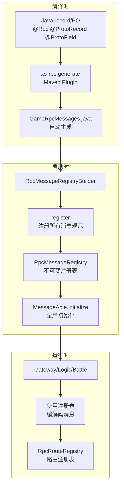

# 消息注册流程

## 概览

消息注册分为三个阶段：编译时生成、启动时初始化、运行时使用。整个流程确保所有节点在启动时拥有完整的消息路由信息。



## 编译时：协议生成

### 输入源

**全量模式**（`game-message-action` 的 `xs-rpc:generate`）只扫描**自身** `src/main/java`，不再扫描 `../game-node-modules`、`../game-node-battle`：

- 手写 `@Rpc` 协议 record，以及 `@ProtoRecord` 声明类（例如 `com.game.message.s2c.PlayerInfoProto`，声明 RPC 2102 的 `PlayerInfoData`）都在这里；
- `roleClass` 一律由 record 实现的 `@Roles` 接口推断，**不再通过扫描业务 Actor 的 handler 反推**；`kind = INTERNAL` 的 DTO 同样必须实现某个 `@Roles` 接口，否则构建失败。

业务模块 `game-node-modules` 自身再跑两次 `xs-rpc:generate`，各自只扫描约定源码、只产出对应代码：

- `convertersOnly = true`：只扫描自身 `src/main/java`，由本模块的 `@ProtoRecord` 源类型（`PlayerPO`）生成 PO → 协议记录的转换器（`GeneratedProtoConverters`），不再扫描 `game-message-action`；
- `handlersOnly = true`：扫描自身 `src/main/java` 与 `../game-message-action/src/main/java`，把「单参数 DTO 处理方法」解析为 `rpcNum → 方法名` 映射，生成 `GeneratedRpcHandlers`（`handlerJavaPackage = com.game.logic.management`）。全量生成不再内联 handler 元数据，方法名由此处补齐。

### 生成产物

`xs-net-rpc-maven-plugin` 执行 `xs-rpc:generate` 目标，产出：

| 文件 | 位置 | 用途 |
|------|------|------|
| `*.proto` | `src/main/proto/` | Protocol Buffers 定义（含 `ActorModels.proto`） |
| `rpc_routes.proto` | `src/main/proto/` | 路由表 proto |
| `rpc_routes.md` | 项目根 | 路由表文档 |
| `GameRpcMessages.java` | `game-message-action/target/generated-sources/rpc/` | 消息注册表装配；全量模式下每条规格的 handler 元数据为 `null` |
| `GeneratedRpcCodec.java` | `game-message-action/target/generated-sources/rpc/` | DTO ↔ Protobuf 编解码 |
| 协议记录源码 | `game-message-action/target/generated-sources/rpc/com/game/message/**` | `@ProtoRecord(classType)`（如 `PlayerInfoProto`）派生的 record |
| `GeneratedProtoConverters.java` | `game-node-modules/target/generated-sources/rpc-converters/` | PO → 协议记录的转换方法（`convertersOnly` 执行，只扫描 node-modules 自身） |
| `GeneratedRpcHandlers.java` | `game-node-modules/target/generated-sources/rpc-handlers/com/game/logic/management/` | `rpcNum → 方法名` 只读映射（`handlersOnly` 执行） |

### ACTOR_MODEL 消息

`@ProtoRecord(classType, number)` 标注的类（在 `game-message-action` 内，例如 `PlayerInfoProto`）会派生一条 `kind = ACTOR_MODEL` 的消息规格：编号取自注解的 `number`，消息名取 `classType` 的简单类名，字段取该声明类上带 `@ProtoField` 的字段（`Timestamp` → `int64` 毫秒），无 `roleClass`（进入 `ActorModels.proto`）、`direction = HTTP_RESPONSE`、`publicVisible = true`。它和其他消息一样进注册表与路由表；引用它的消息字段直接以消息类型引用并复用其 codec。详见 [领域概念](../../framework/xs-net-message/concepts.md#协议声明与生成)。

### GameRpcMessages 结构

```java
public final class GameRpcMessages {
    public static final RpcMessageRegistry INSTANCE;
    
    static {
        RpcMessageRegistryBuilder builder = new RpcMessageRegistryBuilder();
        
        // 注册所有消息规范
        builder.register(new RpcMessageSpec<>(
            1000,                    // rpcNum
            LoginRequest.class,      // messageClass (Protobuf)
            LoginRequest.parser(),   // parser
            LoginRequestDTO.class,   // dtoClass
            PlayerMessage.class,     // roleClass (record 实现的 @Roles 接口)
            RpcMessageDirection.HTTP_RESPONSE,
            true,                    // publicVisible
            true,                    // playerRoutingRequired
            false,                   // channelRoutingRequired
            GeneratedRpcCodec.INSTANCE,
            null                     // handler：全量模式不内联 handler 元数据
        ));
        
        // ... 更多 register 调用
        
        INSTANCE = builder.build();
    }
}
```

全量模式下每条规格的 `handler` 一律为 `null`：插件不再扫描业务 Actor 源码来推断 actorType / methodName。运行期需要「rpcNum → 方法名」的场景（例如 Logic 的 `ProtocolTraceTargetResolver`）改查业务模块 `handlersOnly` 生成的 `com.game.logic.management.GeneratedRpcHandlers.methodNames()`。

## 启动时：注册表初始化

### 各节点初始化入口

所有节点在启动时都调用 `MessageAble.initialize(GameRpcMessages.INSTANCE)`：

**Gateway**（[GameGatewayApplication.java:L18](file:///f:/project/xs-net/game-server/game-node-gateway/src/main/java/com/game/GameGatewayApplication.java#L18)）：
```java
public static void main(String[] args) {
    MessageAble.initialize(GameRpcMessages.INSTANCE);
    // 打印路由信息
    RpcRouteRegistry routes = RpcRouteRegistry.from(GameRpcMessages.INSTANCE);
    routes.all().forEach(route -> 
        log.info("Route: number={} direction={} role={} public={} route={} transports={}",
            route.rpcNumber(),
            route.direction(),
            route.targetRole().getSimpleName(),
            route.publicVisible(),
            route.playerRoutingRequired() ? "player" : "-",
            route.transports()));
    SpringApplication.run(GameGatewayApplication.class, args);
}
```

**Logic**（[LogicNodeRuntime.java:L72](file:///f:/project/xs-net/game-server/game-node-modules/src/main/java/com/game/logic/config/LogicNodeRuntime.java#L72)）：
```java
@Override
public void run(ApplicationArguments args) {
    MessageAble.initialize(GameRpcMessages.INSTANCE);
    // ... 其他初始化
}
```

**Battle**（[GameBattleApplication.java:L22](file:///f:/project/xs-net/game-server/game-node-battle/src/main/java/com/game/battle/GameBattleApplication.java#L22)）：
```java
public static void main(String[] args) {
    MessageAble.initialize(GameRpcMessages.INSTANCE);
    // ... 配置 Actor 消息包路径
    // ... 注册交付拦截器
}
```

### 注册表构建流程

```text
GameRpcMessages.INSTANCE (静态初始化块)
  -> new RpcMessageRegistryBuilder()
  -> builder.register(RpcMessageSpec) × N
       -> 按 rpcNum 索引（去重）
       -> 按 messageClass 索引（去重）
       -> 按 dtoClass 索引（去重）
  -> builder.build()
       -> 返回 ImmutableRpcMessageRegistry
       -> 所有索引转为不可变 Map
```

### MessageAble 全局状态

[MessageAble.java](file:///f:/project/xs-net/xs-net/xs-net-message/src/main/java/com/xs/net/message/MessageAble.java) 持有两个 volatile 静态字段：

```java
private static volatile RpcMessageRegistry registry;
private static volatile RpcEnvelopeFactory envelopeFactory;
```

- **一次性初始化**：JVM 生命周期内只设置一次
- **未初始化时**：所有编解码方法抛出 `IllegalStateException`
- **线程安全**：volatile 保证可见性，但无锁

## 运行时：路由注册表

### RpcRouteRegistry 构建

从 `RpcMessageRegistry` 派生，为每条消息规范生成路由描述符：

```text
RpcRouteRegistry.from(messageRegistry)
  -> messageRegistry.all().stream()
       -> RpcRouteDescriptor.from(spec)
            -> 根据 direction 决定 deliveryClass
            -> 根据 playerRoutingRequired 创建 playerIdExtractor
            -> 根据 channelRoutingRequired 创建 channelIdExtractor
       -> 返回 RpcRouteDescriptor
  -> 构建 RpcRouteRegistry
       -> 按 rpcNum 索引（去重）
```

### RpcRouteDescriptor 职责

封装单条消息的路由配置：

| 字段 | 类型 | 用途 |
|------|------|------|
| `spec` | `RpcMessageSpec` | 消息规范 |
| `deliveryClass` | `RpcDeliveryClass` | 传递类型（REALTIME/RESPONSE/STATE_LATEST/DURABLE_EVENT） |
| `transports` | `Set<TransportKind>` | 支持的传输协议（TCP/UDP/WEBSOCKET） |
| `playerIdExtractor` | `RouteValueExtractor` | 从 DTO 提取 playerId |
| `channelIdExtractor` | `RouteValueExtractor` | 从 DTO 提取 channelId |

### 路由查找

```java
// Gateway 上行路由
RpcRouteDescriptor route = routes.find(rpcNum);
if (route == null) {
    log.warn("Unknown rpc number: {}", rpcNum);
    return;
}

// 提取路由键
String playerId = route.playerId(dto);

// 校验
if (playerId == null && route.playerRoutingRequired()) {
    log.warn("Missing playerId for rpc {}", rpcNum);
    return;
}
```

## 关键设计决策

### 为什么编译时生成而不是运行时扫描

1. **类型安全**：编译时检查所有 @Rpc 注解和 DTO 类型
2. **启动性能**：避免运行时反射扫描大量类
3. **可追溯性**：生成的 `rpc_routes.md` 提供协议文档
4. **跨语言 SDK**：proto 文件可直接用于生成客户端代码

### 为什么 MessageAble 是静态全局

1. **单例约束**：同一 JVM 内只有一套消息注册表
2. **无依赖注入**：框架层不依赖 Spring，保持独立
3. **性能**：静态方法调用比实例方法快
4. **风险**：测试或工具无法重置状态，只能通过显式 API 清理

### 为什么需要两层注册表

- **RpcMessageRegistry**：消息元数据（类型、编解码器、处理器）
- **RpcRouteRegistry**：路由配置（传输协议、提取器、传递类型）

分离关注点：消息定义与路由策略解耦，便于扩展新的路由规则。

## 工程约束

1. **初始化顺序**：`MessageAble.initialize()` 必须在任何消息编解码之前调用
2. **不可变性**：注册表构建后不可修改，新增消息需重新生成
3. **唯一性**：rpcNum、messageClass、dtoClass 必须全局唯一
4. **角色匹配**：`roleClass` 必须与 Actor 实现的接口一致，否则无法路由

## 相关文件

- [xs-net-message 模块](file:///f:/project/xs-net/xs-net/xs-net-message)：消息框架核心
- [GameRpcMessages 模板](file:///f:/project/xs-net/xs-net/xs-net-rpc-maven-plugin/src/main/resources/templates/GameRpcMessages.vm)：Velocity 模板
- [RpcMessageSpec.java](file:///f:/project/xs-net/xs-net/xs-net-message/src/main/java/com/xs/net/message/RpcMessageSpec.java)：消息规范定义
- [RpcRouteRegistry.java](file:///f:/project/xs-net/xs-net/xs-net-message/src/main/java/com/xs/net/message/RpcRouteRegistry.java)：路由注册表
- [MessageAble.java](file:///f:/project/xs-net/xs-net/xs-net-message/src/main/java/com/xs/net/message/MessageAble.java)：全局消息能力
